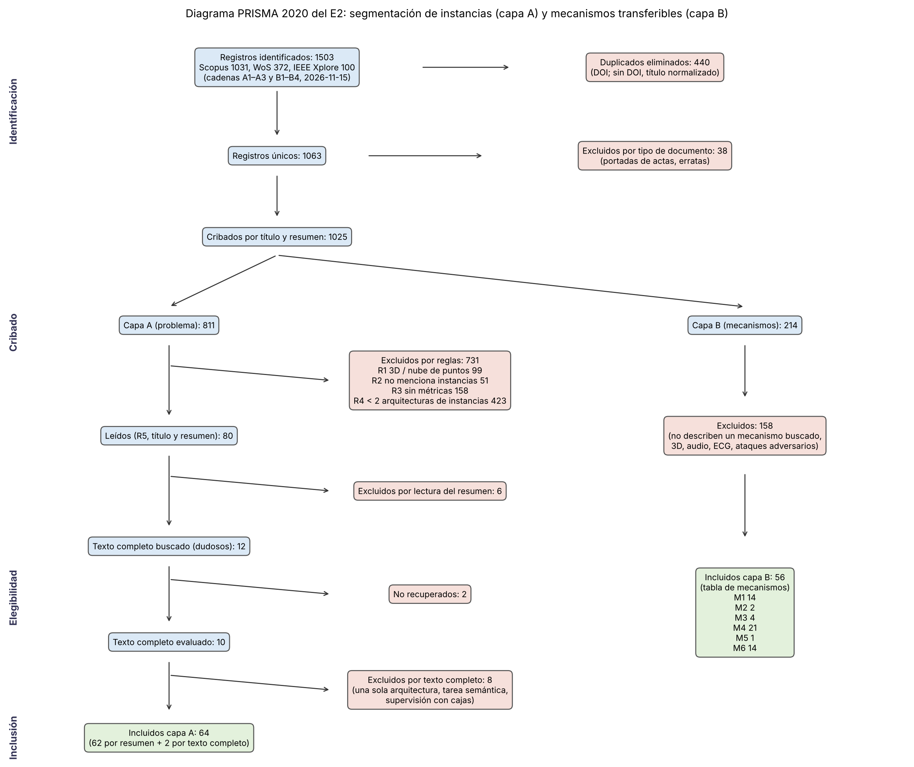

# Revisión de literatura y selección del Top 10

Revisión sistemática de segmentación de instancias de objetos pequeños con aprendizaje profundo, siguiendo PRISMA 2020. Las búsquedas se hicieron el 2026-11-15 en Scopus, Web of Science e IEEE Xplore con las cadenas de [`cadenas_busqueda_E2`](../literatura/e2/cadenas_busqueda_E2.md): A1–A3 (el problema) y B1–B4 (mecanismos transversales de otras modalidades, con `transfer*` o `adapt*`). El registro completo está en [`registro_busquedas_E2`](../literatura/e2/registro_busquedas_E2.md).

## Flujo PRISMA

- Identificados: **1503** (Scopus 1031, Web of Science 372, IEEE Xplore 100).
- Duplicados: 440. Únicos: 1063. Excluidos por tipo de documento (portadas de actas, erratas): 38. Cribados: 1025.
- Capa A (problema): 811 cribados, **64 incluidos**. Exclusiones por regla: R1 (3D) 99, R2 (no menciona instancias) 51, R3 (sin métricas) 158, R4 (menos de 2 arquitecturas) 423, R5 (lectura de título y resumen) 80.
- Capa B (mecanismos): 214 cribados, **56 incluidos**, en 6 mecanismos ([`tabla_mecanismos_E2`](../literatura/e2/tabla_mecanismos_E2.md)).

**Limitaciones que se declaran.** El cribado lo hizo un solo revisor humano con asistencia de IA para la lectura de título y resumen (regla R5); no hay kappa de Cohen. El criterio de calidad de la revista (cuartil) no se aplicó. Se buscó 2018–2026 (nueve años, uno más que el rango preferido): 2026 está incompleto y Mask R-CNN (2017) entra como trabajo fundacional.

## Puntaje y Top 10

Lista larga de 26 modelos con el puntaje `0.25 C + 0.15 R + 0.25 D + 0.20 I + 0.15 F` (citación por año, recencia, AP de máscara en COCO, implementación disponible y representatividad de la familia; definición y ejemplo en [`README`](../literatura/e2/README.md)). Una prueba de sanidad y de memoria en 6 GB filtró los candidatos (F1–F4). Familias: Q (consultas), P (prototipos), R (dos etapas), K (kernels dinámicos).

| # | Modelo | Familia | Año | Citas/año | C | R | D | I | F | Puntaje |
|---|---|---|---|---|---|---|---|---|---|---|
| 1 | Mask2Former | Q | 2022 | 785 | 0.792 | 0.556 | 0.813 | 1.0 | 1.0 | **0.834** |
| 2 | YOLOv7-seg | P | 2023 | 2903 | 1.000 | 0.667 | 0.673 | 0.5 | 1.0 | **0.768** |
| 3 | YOLOv9-seg | P | 2025 | 636 | 0.750 | 0.889 | 0.784 | 0.5 | 0.5 | **0.692** |
| 4 | YOLO26-seg | P | 2026 | 389 | 0.708 | 1.000 | 0.287 | 1.0 | 0.5 | **0.674** |
| 5 | YOLO11-seg | P | 2024 | 1707 | 0.833 | 0.778 | 0.175 | 1.0 | 0.5 | **0.644** |
| 6 | Cascade Mask R-CNN | R | 2021 | 312 | 0.583 | 0.444 | 0.404 | 1.0 | 0.5 | **0.588** |
| 7 | HTC | R | 2019 | 183 | 0.542 | 0.222 | 0.491 | 1.0 | 0.5 | **0.567** |
| 8 | PointRend | R | 2020 | 172 | 0.500 | 0.333 | 0.427 | 1.0 | 0.5 | **0.557** |
| 9 | Mask Scoring R-CNN | R | 2019 | 143 | 0.375 | 0.222 | 0.409 | 1.0 | 0.5 | **0.504** |
| 10 | CondInst | K | 2020 | 86 | 0.167 | 0.333 | 0.409 | 1.0 | 0.5 | **0.469** |

Además del Top 10 se entrenan los tres modelos base del E1 (Mask R-CNN, YOLOv8n-seg y SOLOv2), un baseline no profundo (regresión logística por píxel) y un baseline trivial (máscara vacía). Modelos muy citados que quedaron fuera (SAM, RTMDet, YOLACT, Mask DINO, CenterMask, SOLO, BlendMask y PolarMask) están justificados al final del registro de búsquedas.
